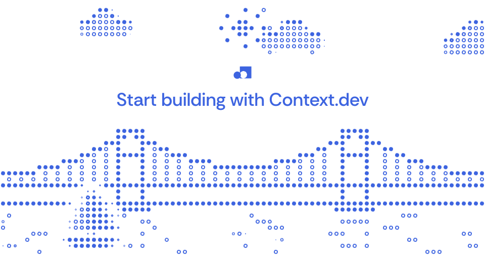
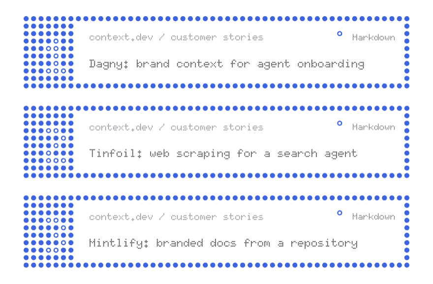
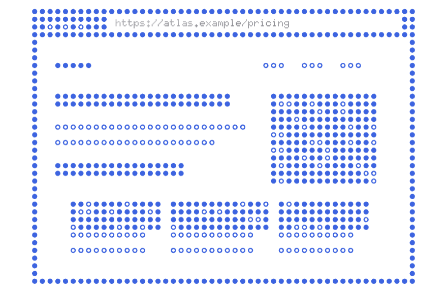
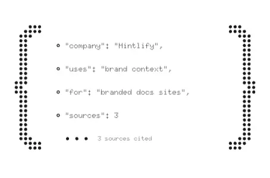
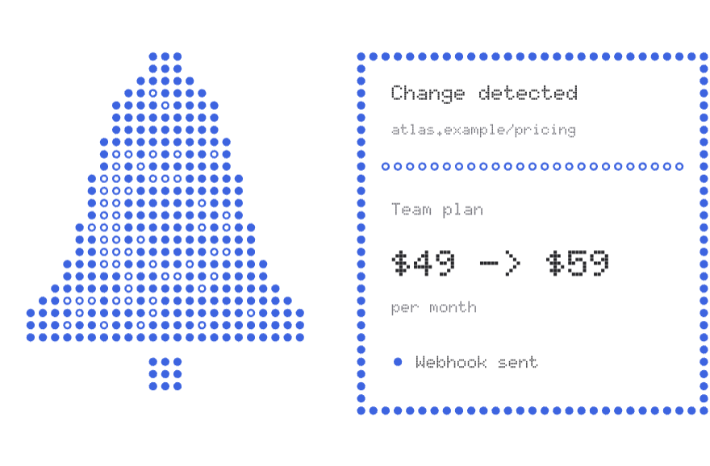
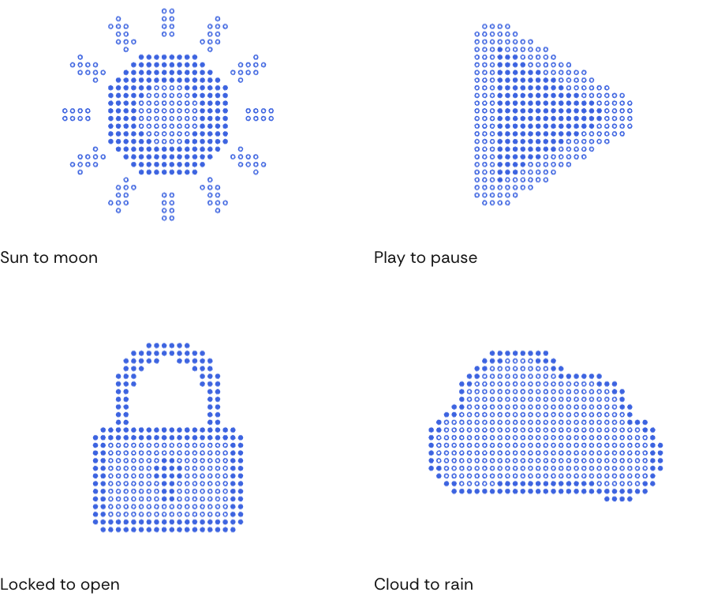
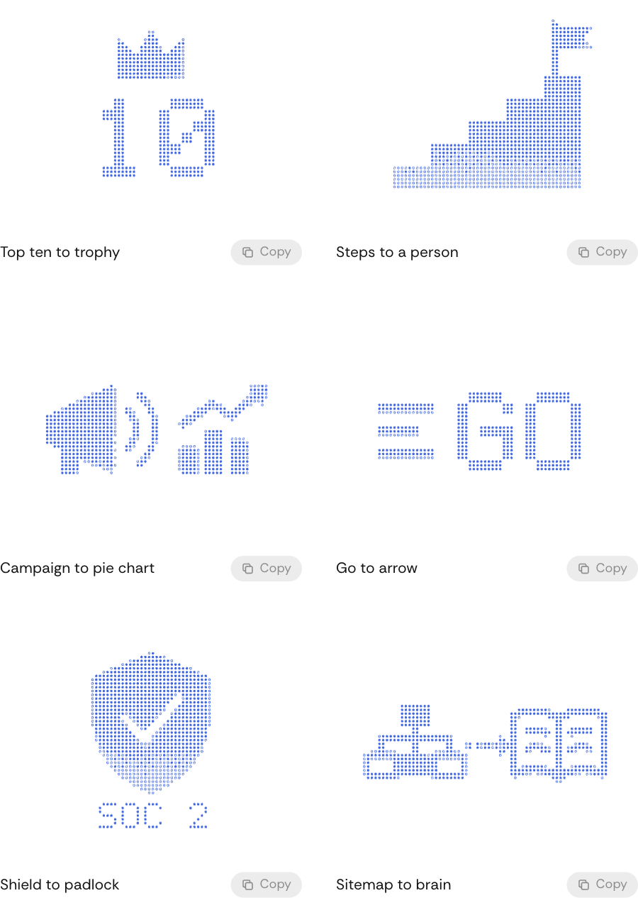
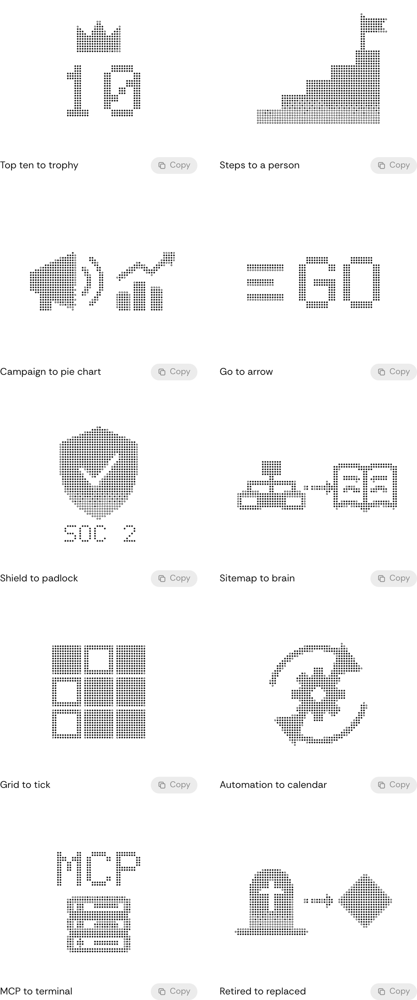
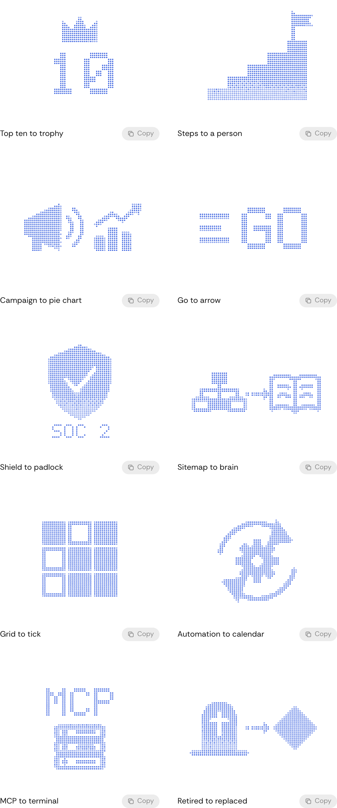

<h1 align="center">Morph</h1>

<p align="center"><b>A skill for Claude Code and Codex that melts dot pictures into each other.</b><br>Show or describe as many pictures as you like, and your agent melts each one into the next.<br>Every picture is a grid of dots, each one solid, a ring or gone: shapes grow necks and run together instead of fading.</p>

<p align="center">
  <a href="https://code.claude.com/docs/en/skills"></a>
  <a href="https://learn.chatgpt.com/docs/build-skills"></a>
  <a href="https://agentskills.io"></a>
  <a href="LICENSE"></a>
  <a href="#how-it-works"></a>
  <a href="#how-it-works"></a>
</p>

<p align="center">
  <a href="https://github.com/markwillcraft/morph/archive/refs/heads/main.zip"></a>
  &nbsp;
  <a href="#install"></a>
</p>

<p align="center">
  <a href="#quick-start">Quick start</a> ·
  <a href="#gallery">Gallery</a> ·
  <a href="#what-it-makes">What it makes</a> ·
  <a href="#install">Install</a> ·
  <a href="#usage">Usage</a> ·
  <a href="#how-it-works">How it works</a> ·
  <a href="#limits">Limits</a> ·
  <a href="#the-site">The site</a>
</p>

<p align="center">
  
</p>

<p align="center"><sub>The site's hero, one whole 30-second loop, at the site's own speed. A single picture that moves while it holds: each mover clears a halo of cells so it reads in front of the bridge.</sub></p>

---

Ask Claude or Codex for dot art that moves, and Morph has it draw each state as its own picture, then melt each one into the next: two for a hover, as many as the story needs for a loop. A sun becomes a moon, a padlock opens, a terminal turns into three search results. Nothing sways, twists or cross-fades: both pictures are laid into one raster, blurred and cut back to a hard edge, and every dot eases its size and fill toward the result, so edges swell and drain.

The agent draws every picture with the canvas API, reads it back into dots, checks every melt for a frame that goes blank, and wires the result to hover, focus or a loop.

## Quick start

For Claude Code:

```sh
mkdir -p ~/.claude/skills && curl -L https://github.com/markwillcraft/morph/archive/refs/heads/main.tar.gz | tar -xz --strip-components=2 -C ~/.claude/skills morph-main/skill/morph
```

For Codex:

```sh
mkdir -p ~/.agents/skills && curl -L https://github.com/markwillcraft/morph/archive/refs/heads/main.tar.gz | tar -xz --strip-components=2 -C ~/.agents/skills morph-main/skill/morph
```

Then ask for a figure. In Claude Code:

```text
/morph a sun that melts into a moon on hover
```

In Codex, the same with `$morph`:

```text
$morph a sun that melts into a moon on hover
```

No API keys and nothing to install: the kit is plain TypeScript with no dependencies, and the agent copies it into your project.

## Gallery

Everything here is on the site's [collection](app/collection/page.tsx) page, which has three shelves: four stories, six moving covers and ten post covers. All of it is [Context.dev](https://context.dev)'s artwork, rebuilt on Morph's kit, and every piece has a **Copy** button for a `/morph` prompt that makes one like it.

### Stories

Context.dev's four product cards. Each is several pictures in a row, played while it is hovered; most steps melt into the next, and a few are built in dot by dot. The same four sit at the top of the home page.

<table>
  <tr>
    <td width="50%"></td>
    <td width="50%"></td>
  </tr>
  <tr>
    <td><sub><b>Search</b>: terminal, results, results read. The keyboard's keys go down as the question is typed.</sub></td>
    <td><sub><b>Scrape</b>: a page scanned top to bottom, then one window that switches between six output formats.</sub></td>
  </tr>
  <tr>
    <td></td>
    <td></td>
  </tr>
  <tr>
    <td><sub><b>Research</b>: question, sources, braces, answer. The braces spread in from the middle, because a melt into one-cell lines goes blank.</sub></td>
    <td><sub><b>Monitor</b>: a day on the clock, then the bell rings and the notice of what changed is built beside it.</sub></td>
  </tr>
</table>

### Moving covers

Context.dev's six blog covers, played as its blog plays them. Hover runs each scene to its second picture, keeps its parts moving while held, and springs them back to rest on leaving. Every frame is drawn in greys with the canvas API and read into dots.

<p align="center">
  
</p>

<p align="center"><sub>Blocked to let through, orbits to a thought, pages to one page, two agents to one, tiles to one picture, source to records.</sub></p>

### Post covers

Ten of Context.dev's blog post covers. Each stores its cover and its hover picture as dots, and the kit melts between them. These ten are the ones whose melt keeps its mass under the kit's check.

<p align="center">
  
</p>

<table>
  <tr>
    <td width="50%"></td>
    <td width="50%"></td>
  </tr>
  <tr>
    <td><sub>Dots paint in the canvas's CSS <code>color</code>.</sub></td>
    <td><sub>So one switch recolours every picture on the page, still ones included.</sub></td>
  </tr>
</table>

Every image here was recorded from the site in headless Chrome with a fake clock, at 40 frames a second with lossless compression, and play at the same speed as on the site.

## What it makes

Three kinds of figure, all on one kit.

| Kind | What it is | Kit | On the site |
|---|---|---|---|
| **Toggle** | Two pictures. Hover, focus or press melts to the second; letting go melts back. It only draws while dots are moving. | `playToggle(canvas, grid, rest, active)` | the collection's [post covers](pictures/context/posts.ts) |
| **Loop** | A row of beats, each a picture that is a pure function of time. Each holds, then melts into the next, and the last melts into the first. It pauses off screen. | `playLoop(canvas, grid, new Loop(grid, beats))` | the [bay](pictures/hero.ts) |
| **Story** | A loop where each beat sets its own hold and melt, so one picture can stay while a question is typed and the next can arrive at once. | `Beat.hold`, `Beat.melt` | the [four stories](pictures/products.ts), on the home page and in the collection |

Under reduced motion a loop holds its first picture and a toggle swaps without melting.

## Install

Morph is a standard [Agent Skill](https://agentskills.io): a folder with a `SKILL.md` at its root. In this repository that folder is [`skill/morph`](skill/morph). Put it where your agent looks for skills:

| Agent | For you | For one project | Run it with |
|---|---|---|---|
| **Claude Code** | `~/.claude/skills/morph` | `.claude/skills/morph` | `/morph` |
| **Codex** | `~/.agents/skills/morph` | `.agents/skills/morph` | `$morph` |

The quickest way is to let your agent do it. Paste this into Claude Code or Codex (the site has a **Copy prompt** button for it):

```text
Install the Morph skill for me from https://github.com/markwillcraft/morph.

1. Work out which agent you are and use its personal skills folder:
   - Claude Code: ~/.claude/skills
   - Codex: ~/.agents/skills
2. Download the repository and put only its skill/morph folder there, as <skills folder>/morph, replacing any older copy. Run the one command for your agent:
   - Claude Code: mkdir -p ~/.claude/skills && curl -L https://github.com/markwillcraft/morph/archive/refs/heads/main.tar.gz | tar -xz --strip-components=2 -C ~/.claude/skills morph-main/skill/morph
   - Codex: mkdir -p ~/.agents/skills && curl -L https://github.com/markwillcraft/morph/archive/refs/heads/main.tar.gz | tar -xz --strip-components=2 -C ~/.agents/skills morph-main/skill/morph
3. Check that <skills folder>/morph/SKILL.md exists, and list the folder so I can see it.
4. Tell me how to start: /morph in Claude Code, $morph in Codex. If the skill doesn't show up, tell me to restart the app.
```

Or pick one of these, and swap the folder for the one above:

| | Command |
|---|---|
| **curl**, Claude Code | `mkdir -p ~/.claude/skills && curl -L https://github.com/markwillcraft/morph/archive/refs/heads/main.tar.gz \| tar -xz --strip-components=2 -C ~/.claude/skills morph-main/skill/morph` |
| **curl**, Codex | `mkdir -p ~/.agents/skills && curl -L https://github.com/markwillcraft/morph/archive/refs/heads/main.tar.gz \| tar -xz --strip-components=2 -C ~/.agents/skills morph-main/skill/morph` |
| **git** | `git clone https://github.com/markwillcraft/morph.git && cp -r morph/skill/morph ~/.claude/skills/` (or `~/.agents/skills/` for Codex) |
| **ZIP** | [Download the ZIP](https://github.com/markwillcraft/morph/archive/refs/heads/main.zip), unpack it, and move `morph-main/skill/morph` into your skills folder. |

The site also serves the skill on its own as `morph.zip` (built from `skill/morph` by [`scripts/zip-skill.mjs`](scripts/zip-skill.mjs)): `unzip morph.zip -d ~/.claude/skills`, or `-d ~/.agents/skills` for Codex.

Claude Code picks up new skills in a running session; if the `skills` folder did not exist when the session started, restart it. Codex lists skills under `/skills`; restart Codex if Morph does not show.

## Usage

Type `/morph` (in Codex, `$morph`) and say what the pictures are and where they go. Two pictures make a hover piece; three or more make a loop or a story.

You don't need an image to start. Describe each picture in words, and the agent draws a first version; then refine it together ("thicker walls", "open the lock wider", "hold the terminal longer") until it reads right. If you do have an image or a sketch, share it and the agent draws from it.

```text
/morph a sun that melts into a moon on hover
```

```text
/morph our logo, looping through the three product icons
```

```text
/morph a four-step story for our pricing card: a cart, a receipt, a box, a truck. Play it on hover.
```

```text
/morph why does the chart-to-list melt go blank halfway?
```

You don't have to name the skill. Claude Code and Codex also load it when you ask to animate dot art, make a dot illustration change on hover, loop a row of dot pictures, or fix a dot melt that flickers or goes blank.

Three habits get the best results:

1. **Give neighbours a shared shape.** Each melt reads best when the next picture keeps some of this one's mass in place: a sun and a moon, a closed and an open lock.
2. **Give pictures mass.** Solid shapes and ring fill melt; one-cell outlines blur away halfway. The kit's check says which.
3. **Say where it lives.** On hover, on a loop, or as a story with steps of different lengths.

## How it works

- **Three states.** A picture is a `Uint8Array`, one byte per cell: empty, ring or solid. Solid carries structure, rings carry fill, and empty cells are what the eye reads as edges.
- **Draw, then read back.** `pictureFromCanvas(grid, draw)` hands you a 2D context in cell units. Draw in black for solid and white for ring; each cell is read back from the 4 × 4 pixels it covers. Paths, text, gradients and clipping all become dots.
- **The melt.** Both pictures are laid into one raster with a handover weight, blurred, and cut back at half coverage. Where two shapes come within a couple of cells, the blur bridges them, so they join before they let go. The tuning lives in `MELT_TUNING`.
- **Dots that ease.** The cut flips cells in steps, so each dot eases its size and fill toward its cell over about 40 ms. A dot on its way out keeps its fill while it shrinks, so it never flashes as a ring.
- **The check.** `thinnestMeltFrame(grid, from, to)` steps through a melt and finds its emptiest frame. Anything under 35% of the smaller picture's dots goes visibly blank.
- **Time in, frame out.** Every loop picture is a pure function of time, so any frame can be drawn on its own: that is what makes a frame checkable and a loop recordable.

<details>
<summary><b>Repository layout</b></summary>

<br>

```text
morph/
├── skill/morph/              the skill: copy this folder into your skills folder
│   ├── SKILL.md              the steps and rules the agent follows
│   ├── kit/                  the library the agent copies into your project
│   │   ├── grid.ts           three states per cell
│   │   ├── paint.ts          canvas drawing to cells
│   │   ├── melt.ts           blur and re-cut
│   │   ├── dots.ts           dots that ease, drawn in one path
│   │   ├── loop.ts           beats on a loop, each with its own timing
│   │   ├── toggle.ts         two pictures and a switch
│   │   ├── play.ts           canvas sizing, frames, offscreen pause, reduced motion
│   │   └── check.ts          finds a melt's emptiest frame
│   └── references/           read when a step needs more: pictures, the melt, checking
├── app/                      the site (Next.js): home, collection, how I built it
├── components/               the players, sidebar and colour switch
├── pictures/                 the site's pictures: the bay, the four stories, the six moving covers
│   └── context/              Context.dev's product pictures and text, blog cover scenes and post covers
└── scripts/zip-skill.mjs     packs skill/morph into public/morph.zip
```

</details>

## Limits

- **Pictures need mass.** One-cell outlines blur away mid-melt; the kit's check catches them. Thicken lines to two or three cells, add ring fill, or build that step in dot by dot instead.
- **Three states per dot, one colour.** No greys inside a picture.
- **Canvas 2D.** Tens of thousands of dots is fine; far past that, move the dots to WebGL.

## The site

The site imports the kit straight from `skill/morph/kit` through `@kit/*`, so every figure on it runs the code the skill ships.

```sh
npm install
npm run dev      # packs skill/morph into public/morph.zip, then starts Next.js
npm run build
```

It needs Node.js 22 or later.

## Credits

Made by Ian Gerado, [@iangerado](https://x.com/iangerado), with Claude Code. The Search, Scrape, Research and Monitor pictures, their text, the blog covers and the Context.dev mark are [Context.dev](https://context.dev)'s, from its product cards and blog. Set in Rethink Sans, with the product text in Doto.

## License

[MIT](LICENSE).
